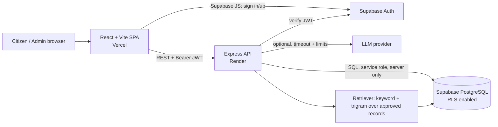
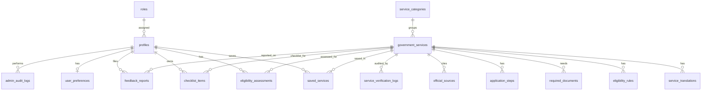

# Digital Public Service Navigator — Architecture & Plan

> Independent navigation and information service. Not an official government website. It does not submit applications to government systems.

## 1. Assumptions

- Core app works with **no AI key**. AI is an optional layer on top of deterministic search.
- Seed records are **demonstration / awaiting verification** unless a reviewer marks them verified through the admin workflow. No record is shown as "verified" by default.
- Official URLs in seed data are limited to well-known root domains (e.g. `myscheme.gov.in`, `scholarships.gov.in`, `services.india.gov.in`); deep links are left empty until a reviewer verifies them.
- Auth, storage and Postgres are provided by Supabase; the backend verifies Supabase JWTs and uses the service-role key only server-side.
- Eligibility is evaluated by a deterministic JSON rules engine; the LLM never decides eligibility.

## 2. Functional requirements (summary)

| Area | Requirement |
|---|---|
| Discovery | Search, category/state filters, sort, pagination, debounced search |
| Eligibility | Per-scheme dynamic questions, 3 outcomes, reasons, missing facts |
| Assistant | Intent extraction, retrieval over approved records, citations, fallback |
| Recommendations | Transparent additive scoring with reasons |
| Accounts | Saved services, checklists, assessment summaries, delete account, export |
| Admin | CRUD, publish/archive, verification queue, CSV import/export, audit log, feedback review |
| i18n/a11y | EN + HI, WCAG 2.2 AA target |

## 3. Non-functional requirements

- Security: JWT verification, backend role checks, RLS, Zod validation, rate limiting, Helmet, CORS allowlist, no secrets in logs.
- Privacy: minimal data; assessments store outcome summary only; search history anonymised and time-limited.
- Reliability: `/health` endpoint, graceful AI timeout/fallback.
- Maintainability: layered backend (routes → controllers → services → repositories), shared types.

## 4. Architecture diagram

Request path for the assistant:
`query → intent extraction (rules) → retrieve approved records → (optional LLM rewrites grounded context) → answer + citations | fallback: templated answer from records`.

## 5. Database ER diagram

## 6. Feature breakdown & phases

1. Foundation: repo, config, migrations, auth middleware.
2. Core: services API, directory, details, eligibility engine, saved services, checklists.
3. Intelligence: recommendations, assistant (+fallback), i18n.
4. Admin: CRUD, verification queue, CSV import, audit log, feedback.
5. Quality: tests, lint, build, a11y checks.
6. Delivery: docs.

## 7. API contract

Envelope: `{ "data": ..., "meta": { page, pageSize, total } }` on success; `{ "error": { "code", "message", "details?" } }` on failure.

Public: `GET /api/services`, `GET /api/services/:id`, `GET /api/categories`, `POST /api/eligibility/evaluate`, `POST /api/assistant/query`, `POST /api/feedback`, `GET /health`.
Authenticated: `GET /api/recommendations`, `/api/user/saved-services` (GET/POST/DELETE), `/api/user/checklists` (GET/POST/PATCH), `/api/user/assessments`, `/api/user/export`, `DELETE /api/user/account`.
Admin (role-gated in backend): `GET/POST /api/admin/services`, `PATCH /api/admin/services/:id`, `DELETE /api/admin/services/:id`, `POST /api/admin/services/import`, `GET /api/admin/services/export`, `GET /api/admin/verification-queue`, `POST /api/admin/services/:id/verify`, `GET /api/admin/feedback`, `GET /api/admin/analytics`, `GET /api/admin/audit-logs`.

Full OpenAPI spec is served at `/api/docs` and kept in `backend/src/config/openapi.ts`.

## 8. Security risks & mitigations

| Risk | Mitigation |
|---|---|
| Privilege escalation via profile update | `role_id` not writable by users (RLS + column grants); only super admin endpoint changes roles |
| Frontend-only admin gating | `requireRole()` middleware on every `/api/admin` route; RLS as second layer |
| LLM hallucination of rules/URLs | Answers built only from retrieved records; URLs taken from DB fields; "Information not verified" fallback |
| Malicious CSV | Zod row validation, size/row limits, URL protocol allowlist (`https` only), no formula execution on export (prefix `'`) |
| PII in logs | Logger redacts auth headers and questionnaire bodies |
| Abuse | Per-IP rate limits, stricter on assistant and feedback |
| XSS | React escaping, no `dangerouslySetInnerHTML`, CSP via Helmet |

## 9. External dependencies

Supabase (Auth + Postgres), optional LLM API, Vercel, Render. No government APIs are assumed or integrated.

## 10. Legal items requiring review

DPDP Act, 2023 obligations (notice, consent, retention, grievance officer), terms of use, and use of official site content/branding must be reviewed by qualified counsel before public launch.

## 11. As built (differences from the plan)
- The backend uses a `Repo` interface with `SupabaseRepo` and `MemoryRepo`; with no Supabase variables (non-production) it serves demonstration data from memory and sign-in is disabled.
- Tokens are verified by calling Supabase Auth (`auth.getUser`), so `SUPABASE_JWT_SECRET` is not needed.
- UI components are hand-built accessible primitives (`frontend/src/components/ui.tsx`) instead of shadcn/ui.
- Added `/api/me` (UI navigation only), `PATCH /api/admin/feedback/:id`, `PATCH /api/admin/users/:id/role`, `GET/PUT /api/user/preferences`.
- Imported or newly created services are always `awaiting_verification`; only `POST /api/admin/services/:id/verify` can set `verified`, and it requires at least one official source.
- Verification evidence: see the table in `PROJECT_REPORT.md`.
